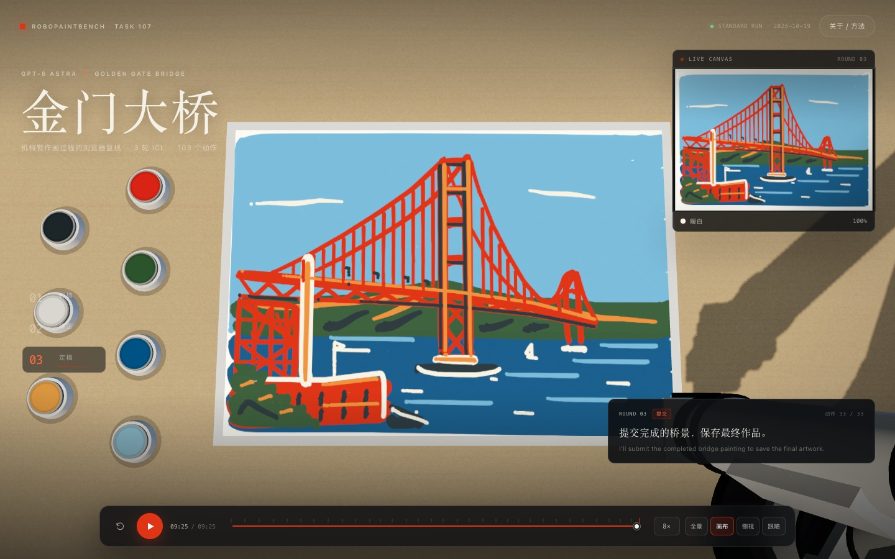
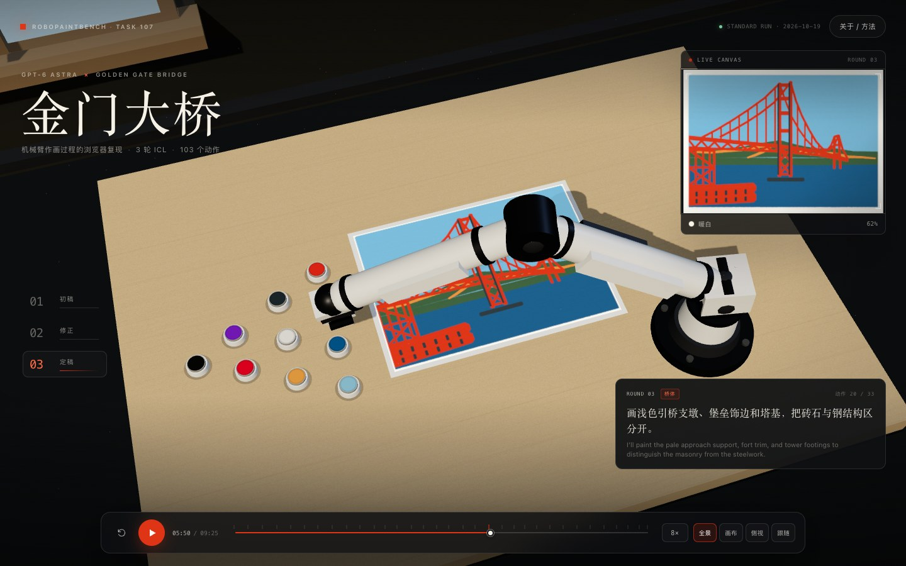
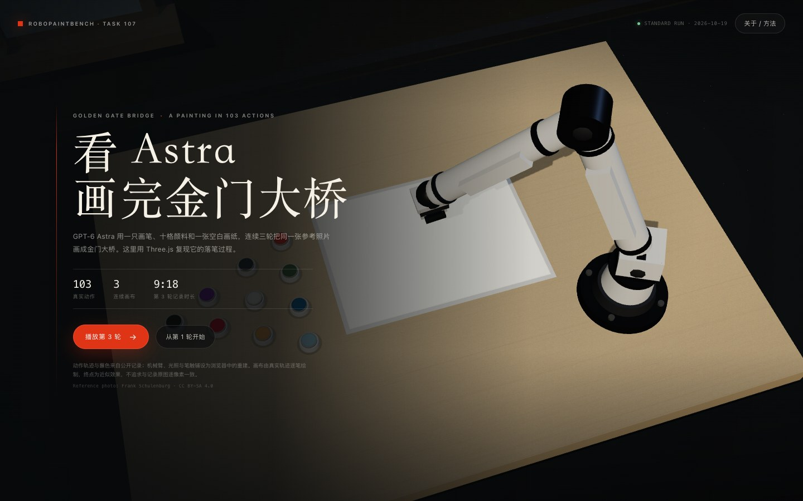

# Astra · 金门大桥 — Three.js 绘画过程复现

一个可直接在浏览器打开的 Three.js 演示：把 **GPT-6 Astra** 在 RoboPaintBench 金门大桥任务里的三轮作画过程，重建成「机械臂在桌面上逐步落笔，画布上逐渐出现金门大桥」的 3D 场景。

动作轨迹、动作时长和蘸色选择来自已公布的评测记录；每轮记录画布也作为对照保留。机械臂、桌面、颜料盘、光照和笔触铺设为浏览器近似重建：**画布由记录轨迹逐笔绘制，终点接近但不等同于原始 PNG**。







## 快速开始

**方式一：直接打开**

双击 `index.html`。页面不依赖网络、模型 API 或本地服务。

**方式二：本地静态服务**

```bash
cd web/astra-golden-gate
python3 -m http.server 8000
# 打开 http://127.0.0.1:8000/
```

Chrome / Edge / Safari / Firefox 现代版本均可。建议使用独立显卡或开启硬件加速；无 GPU 的 SwiftShader 也能运行，但会慢一些。

## 操作

| 操作 | 说明 |
| --- | --- |
| `播放第 3 轮` | 从空白画布开始复现终轮，约 70 秒（8×） |
| `从第 1 轮开始` | 三轮连续播放；每轮结束自动换新画纸 |
| 轮次 01 / 02 / 03 | 切换任意一轮的完整过程 |
| 空格 | 播放 / 暂停 |
| `1` / `2` / `3` | 切换轮次 |
| `R` | 重播当前轮 |
| `←` / `→` | 前后跳 5 秒 |
| `C` | 循环切换镜头 |
| 拖动 / 滚轮 | 旋转 / 缩放视角 |
| 时间轴 / 动作刻度 | 跳转到任意动作；画布按该时刻重绘 |
| 全景 / 画布 / 侧视 / 跟随 | 四个镜头预设；跟随模式锁定笔尖 |
| 8× | 点击切换 1× / 2× / 4× / 8× / 16× 播放速度 |

> 时间轴显示的是「重建时间轴」，包含动作间的小停顿；右下角总时长比记录中动作时长略长，属正常现象。

## 数据来源

| 项目 | 值 |
| --- | --- |
| 任务 | AgentArk **Task 107 · RobotPainting**，金门大桥参考图，seed 107 |
| 模型 | **GPT-6 Astra**（`gpt-6-astra`） |
| 推理接入 / 强度 | Codex SDK / `ultra` |
| 记录日期 | 2026-10-19 |
| 轮次 / 动作数 | 3 轮连续 ICL；**39 / 31 / 33**，共 **103** 个动作 |
| 记录文件 | [`RobotPainting_gpt-6-astra_results.jsonl`](https://huggingface.co/datasets/P90-RushB/AgentArk/resolve/1d4f382a163256a9f75e3817b68698c1e73e6fa1/artifacts/records/0100-0199/0107-RobotPainting/golden_gate/gpt-6-astra/20261019-codex-ultra/RobotPainting_gpt-6-astra_results.jsonl) |
| 记录 SHA-256 | `37397383039d85bcbb76a8e4ccde699a90591fdbf900c8bf0a9bd7059bc72c61` |
| 参考照片 | Frank Schulenburg，[Wikimedia Commons](https://commons.wikimedia.org/wiki/File:Golden_Gate_Bridge_as_seen_from_Battery_East.jpg)，**CC BY-SA 4.0** |

三轮记录画布（`assets/painting-01..03.png`）是记录中保存的原始文件，字节完全一致，作为“记录原图”对照保留；页面不使用它们的像素生成画面：

| 轮次 | 文件 | SHA-256 | 字节 |
| --- | --- | --- | ---: |
| 01 | `assets/painting-01.png` | `7da5a855…fcb496cd` | 192,622 |
| 02 | `assets/painting-02.png` | `10ac1724…2131e5fb25` | 188,640 |
| 03 | `assets/painting-03.png` | `3196b321…28fc4d4e5c` | 187,737 |

完整 SHA 也写在 `data.js` 的 `meta.paintingSha256` 里。

## 忠实度边界：什么是真实的，什么是重建的

**真实数据**

- 每个动作的末端位置、时长和动作顺序；
- 每个动作前是否蘸取颜料，以及蘸的是哪一格（由动作坐标和颜料盘位置对应）；
- 每轮结束时的完整记录画布 PNG（仅作对照）。

**浏览器重建**

- Panda 机械臂、夹爪、画笔、桌面、颜料盘、窗、光照和阴影；
- 由末端轨迹反解的机械臂姿态（两段式 IK + 少量前臂伸缩）；
- 笔刷沉积：每个折线点按记录的笔高 z 换算笔触宽度，在 Canvas 2D 上逐笔叠加颜料；纸边、纸纹和笔毛纹理也是程序生成的。
- 中间状态是根据真实轨迹重建的近似画布，不是原始 Unity 渲染器逐帧的中间画布。

**最终画布是重建的**

- 页面在 100% 时显示的是 Canvas 2D 逐笔绘制的近似结果；颜色、构图和主要笔触路径来自记录，但边缘、笔毛纹理和细节不会与记录 PNG 逐像素一致。
- 完成弹窗中的「保存画作」下载这张模拟画布；「记录原图」链接下载 `assets/painting-03.png` 等原始文件。
- 所以：**过程和终点都是重建的，记录原图另存作对照。**

这也意味着它不是官方 Unity Player 的像素级仿真，不是模型复跑，也不构成画质评分或模型排名。动作轨迹来自标准 benchmark 记录；页面不调用任何模型。

## 实现要点

- `data.js`：103 个动作的 `[x, y, z, duration]` 轨迹、动作文本、中文摘要、颜料盘和三轮记录画布路径/哈希。
- 坐标：Unity 右手式记录的 `(x, y, z)` 映射到 Three.js 的 `(x, z, -y)`；画纸矩形约为 `0.469 m × 0.332 m`。
- 画布：离屏 Canvas 2D 1024×725，程序生成纸底和纸边；笔刷为预生成的彩色笔毛印章，沿动作折线按约 1.15 px 间隔沉积。
- 笔触宽度：`strokeWidthPx(z)` 把记录笔高映射到 43→0 px；笔越低越宽，抬笔收细。颜色来自蘸色动作与颜料盘坐标的对应。
- 播放与拖动时间轴共用同一套「整段笔刷格点」：逐帧播放时只取当前时间片的格点，不会因为每帧重新计算短段而漏点；时间轴跳转则从空白画布重放同一批格点。
- 贴图：`THREE.CanvasTexture` 同时用于 3D 纸面和 LIVE CANVAS 预览；`file://` 打开也不涉及图片纹理跨域。
- 机械臂：程序化几何体 + 两段平面 IK；当记录点刚好超出名义臂展时，前臂沿肘-腕方向少量拉伸，保证笔尖仍落在真实轨迹上。
- 预览窗口：同一个 renderer 用 `setScissor`/`setViewport` 在右上角绘制正交画布视图，不额外创建 WebGL 上下文。

## 文件结构

```text
web/astra-golden-gate/
├── index.html                 # 页面与 UI
├── styles.css                 # 视觉样式
├── app.js                     # Three.js 场景、机械臂、Canvas 笔刷沉积、播放器
├── data.js                    # 103 个动作 + 颜料盘 + 记录画布路径/哈希
├── lib/three.min.js           # Three.js r160 UMD（MIT）
├── assets/
│   ├── painting-01..03.png    # 记录原图（字节一致，仅作对照）
│   └── reference.jpg          # 960×600 展示用参考照片缩略图
├── preview-intro.jpg
├── preview-process.jpg
└── preview-final.jpg
```

## 验证记录

- 在 macOS + Chrome 157 headless（CDP / SwiftShader）下检查：1440×900 与 390×844；HTTP 与 `file://` 两种打开方式；无 JavaScript 错误。
- 三轮画面切换、连续播放、自动换轮、时间轴跳转、动作刻度点击、完成弹窗、参考对比滑块、保存模拟画作和记录原图下载均已人工检查。
- 终轮 100% 时，画纸上的天空采样为 `#7bbddc`；从 0 连续播放到终点与直接 seek 到终点的画面视觉一致，不再出现逐帧累积造成的点阵。
- 完成弹窗使用模拟画布，另提供记录原图下载。
- 页面中唯一的控制台提示是 Three.js UMD 版本的弃用提示（r150+）与 SwiftShader 的性能提示，不影响功能。

## 许可与致谢

- 演示代码遵循本仓库的 **Apache-2.0** 许可（见 [`../../LICENSE`](../../LICENSE)）。
- Three.js r160：**MIT**，许可头保留在 `lib/three.min.js` 中。
- 参考照片：**Frank Schulenburg**，CC BY-SA 4.0；`assets/reference.jpg` 是同一照片的 960×600 展示缩略图，仍按 CC BY-SA 4.0 使用。画作与评测资料来自 **RoboPaintBench / AgentArk**。
- 灵感来自 [Thijs Simonian 的 Bot Ross](https://thijs.net/projects/robot-painter)；本项目是 RoboPaintBench 的浏览器可视化扩展，不是官方 Unity 环境的替代。

来源与许可细节也见仓库的 [attribution](../../docs/attribution.md) 与 [README.zh-CN](../../README.zh-CN.md)。
